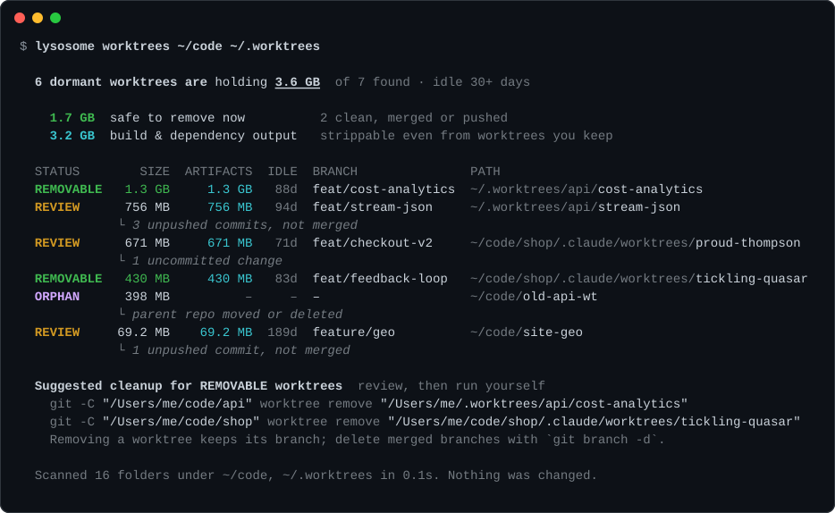

# lysosome

[](https://github.com/lysosome-dev/cli/actions/workflows/ci.yml)
[](https://github.com/lysosome-dev/cli/releases/latest)
[](LICENSE)

**The disk cleaner for the agentic coding era.**

Claude Code, Cursor and parallel agents create git worktrees constantly, and nothing cleans them up. Each dormant worktree drags its own `node_modules`, `target` or `.venv`. Add build artifacts, package caches, local AI models, Docker and Xcode data, and your SSD fills up fast.

`lysosome` shows you where the disk went, labels every item by how safe it is to delete, and (soon) cleans it up safely.

> 🚧 Under active development. `lysosome scan` (idle project artifacts, dormant worktrees, plus everything `lysosome caches` finds: package caches, AI models, Docker, Xcode) is here; safe cleanup is next. See [docs/SPEC.md](docs/SPEC.md).

<p align="center"></p>

## Install

macOS (Apple silicon and Intel) and Linux (x86_64 and arm64). `git` must be on your `PATH`.

**Homebrew** (installs the man pages and bash/zsh/fish completions too):

```bash
brew install lysosome-dev/tap/lysosome
```

**Install script** (puts `lysosome` in `$XDG_BIN_HOME` or `~/.local/bin` and adds it to your `PATH`; set `LYSOSOME_INSTALL_DIR` to choose another folder, `LYSOSOME_NO_MODIFY_PATH=1` to leave your shell config alone):

```bash
curl -fsSL https://lysosome.dev/install.sh | sh
```

**Prebuilt binaries**: download an archive for your platform from the [latest release](https://github.com/lysosome-dev/cli/releases/latest) and check it against its `.sha256` file. Each archive holds the binary, man pages (`man/`) and shell completions (`completions/`).

**From source** (needs a [Rust toolchain](https://rustup.rs), 1.85+):

```bash
cargo install --locked --git https://github.com/lysosome-dev/cli lysosome
```

Check the install with `lysosome --version`.

### Shell completions

Homebrew sets these up for you. Otherwise:

```bash
lysosome completions zsh > "${fpath[1]}/_lysosome"                              # zsh
lysosome completions bash > ~/.local/share/bash-completion/completions/lysosome # bash
lysosome completions fish > ~/.config/fish/completions/lysosome.fish             # fish
```

`powershell` and `elvish` work too.

## Quick start

```bash
lysosome scan                            # artifacts, worktrees, caches, models, Docker, Xcode
lysosome scan ~/code ~/.worktrees        # scan specific folders (faster)
lysosome scan --days 180                 # only call projects idle 180+ days dormant
lysosome scan --all                      # also list active items
lysosome scan --json | jq .summary       # machine-readable output
```

```text
  81 projects untouched for 30+ days are holding 49.4 GB of dependencies and build output.

    53.2 GB  reclaimable now         REMOVABLE items in every section
     5.7 GB  regenerable             cheap to rebuild (build output, caches, merged worktrees)
    47.5 GB  regenerable_expensive   costly to get back (dependencies to re-download)
    13.2 GB  review                  a human should look first
    Tier totals cover every idle item; each byte is counted once.

  ── Git worktrees  17.0 GB idle in 55 items of 105
     (the same table as `lysosome worktrees`, below)

  ── Project build & dependency output  49.4 GB idle in 383 items of 448

    STATUS     TIER       SIZE  IDLE  KIND          PATH
  ~/code/augie  3.6 GB · idle 467d
    REMOVABLE  costly   1.8 GB  467d  node_modules  node_modules
    REMOVABLE  costly   1.3 GB  467d  node_modules  packages/web-app/node_modules
    REMOVABLE  costly   186 MB  467d  node_modules  packages/remotion-lambda/node_modules
    REMOVABLE  cheap   27.5 MB  467d  build         packages/web-app/build
    REMOVABLE  cheap    7.9 MB  467d  dist          packages/components/dist
    … 8 more folders (116 MB)
  ~/code/rust-engine  2.1 GB · idle 212d
    REMOVABLE  cheap    2.1 GB  212d  target        target
  … 79 more (use --top N)

  Scanned 22,055 folders under ~/code, ~/.worktrees in 34.9s. Nothing was changed.
```

### How `scan` decides

- **Artifacts** are the git-ignored folders `node_modules`, `.venv`, `venv`, `target`, `.next`, `.nuxt`, `.svelte-kit`, `.turbo`, `dist`, `build`, `.gradle`, `Pods`, `.dart_tool`, `.build`, `coverage`, `.parcel-cache`, `.expo` (and `DerivedData`) inside any repository under the roots. A folder only counts if `git check-ignore` confirms it, so a tracked `build/` is never touched. Symlinks are never followed.
- **Staleness** is per project: the newest of its last commit and its git index / `HEAD` / reflog timestamps. Artifacts of a project idle `--days`+ (default 30) are `REMOVABLE`; otherwise `ACTIVE`.
- **Tiers**: installed dependencies (`node_modules`, `.venv`, `venv`, `Pods`) are `regenerable_expensive` (you'll re-download them); everything else is `regenerable` build output.
- **No double counting**: artifacts inside a dormant worktree are part of that worktree's row, never listed again; each folder belongs to its innermost repository; nested artifact folders fold into the outer one.
- Rows group by project, largest first (top 5 folders per project; `--top` counts projects).

`lysosome worktrees` is the worktree section on its own:

```bash
lysosome worktrees                       # scan your home folder
lysosome worktrees ~/code ~/.worktrees   # scan specific folders (faster)
lysosome worktrees --days 14             # call anything idle 14+ days dormant
lysosome worktrees --all                 # also list active worktrees
lysosome worktrees --json | jq .summary  # machine-readable output
```

```text
  14 dormant worktrees are holding 18.6 GB  of 41 found · idle 30+ days

     6.1 GB  safe to remove now          9 clean, merged or pushed
    12.9 GB  build & dependency output   strippable even from worktrees you keep

  STATUS        SIZE  ARTIFACTS  IDLE  BRANCH                  PATH
  REVIEW      6.7 GB     4.0 GB   72d  feat/checkout-v2        ~/code/shop/.claude/worktrees/proud-thompson
             └ 1 uncommitted change
  REMOVABLE   3.1 GB     3.0 GB   89d  feat/cost-analytics     ~/code/app-worktrees/marinating-stream
  REVIEW      2.4 GB     2.3 GB   95d  feat/stream-json        ~/code/app-wt-pr2
             └ 8 unpushed commits, not merged
  REMOVABLE   954 MB     949 MB   84d  feat/feedback-loop      ~/code/app-worktrees/tickling-quasar
  ORPHAN      412 MB          –     –  –                       ~/code/old-api-wt
             └ parent repo moved or deleted
  REVIEW     65.5 MB          –  190d  feature/geo             ~/code/site/.claude/worktrees/warm-hare
             └ no remote and not merged

  2 stale worktree records point at deleted folders  harmless; `git worktree prune` clears them
    ~/code/app  →  ~/code/app-worktrees/old-experiment

  Suggested cleanup for REMOVABLE worktrees  review, then run yourself
    git -C "/Users/me/code/app" worktree remove "/Users/me/code/app-worktrees/marinating-stream"
    git -C "/Users/me/code/app" worktree remove "/Users/me/code/app-worktrees/tickling-quasar"
    Removing a worktree keeps its branch; delete merged branches with `git branch -d`.

  Scanned 22,871 folders under ~/code, ~/.worktrees in 6.3s. Nothing was changed.
```

### What the statuses mean

| Status | Meaning |
|---|---|
| `REMOVABLE` | Idle `--days`+ (default 30), clean, and its commits are safe: merged into the default branch or fully pushed. |
| `REVIEW` | Idle, but holding something that might matter: uncommitted changes, untracked files, a lock, or commits that exist nowhere else. The reason is shown underneath. |
| `ORPHAN` | Its parent repository was moved or deleted, so git can no longer manage it. |
| `ACTIVE` | Used recently. Hidden unless you pass `--all`. |

"Idle" is the newest of the worktree's git index / `HEAD` / reflog timestamps and its last commit. **ARTIFACTS** is the space in git-ignored build and dependency folders (`node_modules`, `target`, `.venv`, `dist`, ...) inside the worktree. You can strip those even from worktrees you keep.

Squash-merged branches show as `REVIEW` (git can't tell that a squash merge landed). That's the safe default.

### Flags

| Flag | Default | |
|---|---|---|
| `--days N` | `30` | Idle days before a project or worktree counts as dormant |
| `--depth N` | `8` | Maximum folder depth to search for repositories |
| `--all` | | Also list active worktrees |
| `--top N` | `30` | Rows (or, in `scan`, projects) to show per section |
| `--json` | | Print the versioned JSON report instead of a table |
| `--profile` | | Print phase (walk / git / size / artifacts) and per-detector timings to stderr |
| `--no-color` | | Disable color (`NO_COLOR` is honored too; color is off when piped) |

## What it finds: caches, AI models, Docker, Xcode

```bash
lysosome caches                          # everything below, grouped by category
lysosome caches --category ai_models     # just local AI models (repeatable)
lysosome caches --json                   # same versioned JSON contract
```

`lysosome caches` (alias `system`) checks the places dev tools hide gigabytes. It asks each tool where its data lives when it can (`brew --cache`, `go env GOMODCACHE`, `pnpm store path`, `docker system df`, `xcrun simctl`), with short timeouts, and skips anything that isn't installed. Docker is only queried if it's already running; nothing is ever started or changed.

| Category | What | Tier |
|---|---|---|
| AI models | Ollama models by name (`llama3.1:8b`; shared layers counted once), Hugging Face hub repos (`meta-llama/Llama-3-8B`, honors `HF_HOME`), LM Studio models, `~/.cache/torch`, whisper models | costly |
| Containers | Docker images (unused → removable, in use → review), build cache, volumes (review); OrbStack data (review) | costly / cache / review |
| Xcode (macOS) | DerivedData, `iOS DeviceSupport` per version, simulator runtimes and unavailable simulators, Archives (review: dSYMs) | cache / costly / review |
| Package caches | npm, pnpm, Yarn, Bun, pip, uv, conda, Cargo, Go module + build cache, Gradle, Maven, Homebrew, CocoaPods | cache |
| Android | emulators (AVDs), SDK system images | costly |
| Editors | VS Code and Cursor caches, JetBrains caches | cache |

Tiers: **cache** (`regenerable`) is refilled on demand; **costly** (`regenerable_expensive`) can be re-downloaded but it takes time and bandwidth, and the JSON includes `details.redownload_bytes`; **review** may hold something you can't rebuild. Every finding names the tool's own cleanup command where one exists (`npm cache clean --force`, `brew cleanup -s`, `go clean -modcache`, `docker builder prune --force`, `xcrun simctl delete unavailable`, `ollama rm <model>`), otherwise the folder to move to the Trash.

## JSON output

`--json` prints a stable, versioned document (described by [`schema/lysosome.schema.json`](schema/lysosome.schema.json), JSON Schema 2020-12). Only additive changes happen within a `schema_version`.

```json
{
  "schema_version": 1,
  "tool_version": "0.1.0",
  "scanned_roots": ["/Users/me/code"],
  "dormant_after_days": 30,
  "summary": {
    "reclaimable_bytes": 6100000000,
    "by_tier": { "regenerable": 6100000000, "regenerable_expensive": 0, "review": 12500000000 },
    "by_category": { "worktrees": 18600000000, "artifacts": 0, "ai_models": 0, "xcode": 0, "...": 0 }
  },
  "findings": [
    {
      "id": "worktree:/Users/me/code/app-worktrees/marinating-stream",
      "category": "worktrees",
      "kind": "worktree",
      "path": "/Users/me/code/app-worktrees/marinating-stream",
      "size_bytes": 3100000000,
      "tier": "regenerable",
      "status": "REMOVABLE",
      "reason": "clean, merged into origin/main",
      "last_activity": "2026-07-12T18:04:11Z",
      "details": { "branch": "feat/cost-analytics", "unpushed": 0, "changed": 0, "untracked": 0, "artifact_bytes": 3000000000, "...": "..." },
      "cleanup": { "action": "command", "command": ["git", "-C", "/Users/me/code/app", "worktree", "remove", "/Users/me/code/app-worktrees/marinating-stream"] }
    }
  ],
  "stale_metadata": [],
  "skipped": { "permission_denied": 0, "other_errors": 0, "missing_roots": [] }
}
```

- Sizes are allocated bytes on disk (like `du`), with hard links counted once. APFS clones may be over-counted.
- `summary.reclaimable_bytes` counts `REMOVABLE` findings only: space you can get back now with no risk.
- `summary.by_tier` and `summary.by_category` sum every dormant (non-`ACTIVE`) finding.
- `cleanup` is `null` for anything that isn't `REMOVABLE`. Otherwise `action` says how: `"command"` runs `command` (the tool's own cleanup, e.g. `git worktree remove`); `"trash"` moves `paths` to the Trash (artifact folders).
- `lysosome scan --json` includes every finding from every section. Artifact findings have `category: "artifacts"`, `kind` set to the folder name (`node_modules`, `target`, ...), and `details` with `project`, `project_kind`, `idle_days` and `relative_path`:

```json
{
  "id": "node_modules:/Users/me/code/augie/node_modules",
  "category": "artifacts",
  "kind": "node_modules",
  "path": "/Users/me/code/augie/node_modules",
  "size_bytes": 1800000000,
  "tier": "regenerable_expensive",
  "status": "REMOVABLE",
  "reason": "git-ignored; project idle 467 days",
  "last_activity": "2025-06-30T17:12:40Z",
  "details": { "project": "/Users/me/code/augie", "project_kind": "repo", "idle_days": 467, "relative_path": "node_modules" },
  "cleanup": { "action": "trash", "paths": ["/Users/me/code/augie/node_modules"] }
}
```

## Safety rules

These are non-negotiable. Breaking any of them is a release-blocking bug.

1. **Scanning never modifies anything.** No writes, no index refresh, no lock files. Every git call uses `git --no-optional-locks`. A test snapshots every file's mtime and hash before and after a scan.
2. **Timestamps are read before git runs**, so git can never skew "last used".
3. **Never remove or suggest removing a worktree** that has uncommitted changes or untracked files, is locked, or has commits that are neither merged into the default branch nor pushed.
4. **A folder only counts as an artifact if git ignores it** (`git check-ignore`). Tracked source is never called junk.
5. **Deletion (coming soon) goes to the macOS Trash by default**, uses each tool's own cleanup command (`git worktree remove`, `docker image prune`, `brew cleanup`, ...), and defaults to dry-run.
6. **Symlinks are never followed** during walks or size calculations.
7. **When unsure, `REVIEW`**, never `REMOVABLE`.

## Development

```bash
cargo build
cargo test --workspace        # needs git; the prototype parity test also uses python3
cargo fmt --all
cargo clippy --workspace --all-targets -- -D warnings
```

- `crates/lysosome-core`: discovery, analysis, sizing and classification. Returns data and never prints.
- `crates/lysosome-cli`: the `lysosome` binary (arguments, table/JSON output, progress).
- `tests/fixtures/make_worktrees.sh`: builds a throwaway tree of worktrees in every state (isolated `HOME` / `GIT_CONFIG_GLOBAL`).
- `tests/fixtures/make_projects.sh`: old and fresh repos with ignored and tracked artifact folders, symlinks and worktrees for `lysosome scan`.
- New scanners implement `lysosome_core::detector::Detector` and are registered in `lysosome_core::detectors::all_detectors()`; `scan` renders any category without CLI changes.
- `reference/wtscan.py`: the Python prototype the Rust port must agree with.

See [CONTRIBUTING.md](CONTRIBUTING.md) for the full workflow and how releases are cut, [SECURITY.md](SECURITY.md) to report a vulnerability, and [CHANGELOG.md](CHANGELOG.md) for what changed.

## License

MIT
