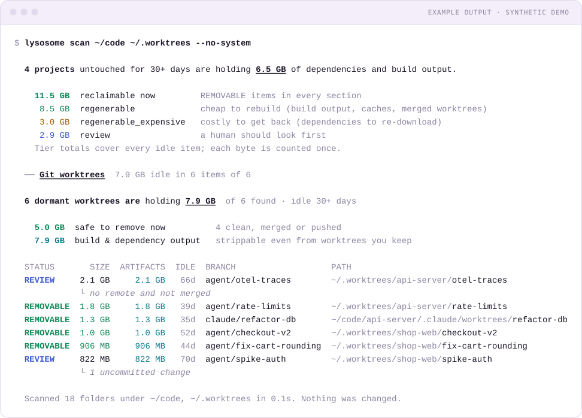

<h1>
  <a href="https://lysosome.dev">
    <picture>
      <source media="(prefers-color-scheme: dark)" srcset="https://raw.githubusercontent.com/lysosome-dev/brand/main/logo/svg/lockup-horizontal-on-dark.svg">
      
    </picture>
  </a>
</h1>

[](https://github.com/lysosome-dev/cli/actions/workflows/ci.yml)
[](https://github.com/lysosome-dev/cli/releases/latest)
[](LICENSE)

**The disk cleaner for the agentic coding era.**

Claude Code, Cursor and parallel agents create git worktrees constantly, and nothing cleans them up. Each dormant worktree drags its own `node_modules`, `target` or `.venv`. Add build artifacts, package caches, local AI models, Docker and Xcode data, and your SSD fills up fast.

`lysosome` shows you where the disk went, labels every item by how safe it is to delete, and cleans it up safely: dry run by default, the Trash by default, and every item re-checked right before it's touched.

> 🚧 Under active development. `lysosome scan` (idle project artifacts, dormant worktrees, plus everything `lysosome caches` finds: package caches, AI models, Docker, Xcode) and `lysosome clean` are here. See [docs/SPEC.md](docs/SPEC.md).

<p align="center"><picture><source media="(prefers-color-scheme: dark)" srcset="docs/assets/scan-dark.svg"></picture></p>

## Why lysosome?

- **Built for agent-heavy workflows.** Claude Code, Cursor and other agents spin up a git worktree per task. lysosome finds the dormant ones and tells you which are truly safe to drop: clean, nothing untracked, not locked, and every commit merged or pushed.
- **One scan, the whole machine.** Idle `node_modules` / `target` / `.venv`, package caches, local AI models (Ollama, Hugging Face, LM Studio), Docker, Xcode and simulators, with sizes measured like `du`.
- **Safe by construction.** Scans are read-only, cleanup is a dry run until you confirm (`--yes` or the prompt), files go to the Trash, every item is re-checked right before it's touched, and anything uncertain is labelled `REVIEW` and never removed.
- **Scriptable.** A versioned `--json` contract for dashboards, CI and agents.

**Mac app (coming soon):** lysosome for the Mac, built on the same engine. [Join the waitlist at lysosome.dev](https://lysosome.dev).

## Install

macOS (Apple silicon and Intel) and Linux (x86_64 and arm64). `git` must be on your `PATH`.

**Homebrew** (installs the man pages and bash/zsh/fish completions too):

```bash
brew install lysosome-dev/tap/lysosome
```

**Install script** (puts `lysosome` in `$XDG_BIN_HOME` or `~/.local/bin` and adds it to your `PATH`; set `LYSOSOME_INSTALL_DIR` to choose another folder, `LYSOSOME_NO_MODIFY_PATH=1` to leave your shell config alone):

```bash
curl -fsSL https://lysosome.dev/install.sh | sh
```

**Prebuilt binaries**: download an archive for your platform from the [latest release](https://github.com/lysosome-dev/cli/releases/latest) and check it against its `.sha256` file. Each archive holds the binary, man pages (`man/`) and shell completions (`completions/`).

**From source** (needs a [Rust toolchain](https://rustup.rs), 1.85+):

```bash
cargo install --locked --git https://github.com/lysosome-dev/cli lysosome
```

Check the install with `lysosome --version`.

### Shell completions

Homebrew sets these up for you. Otherwise:

```bash
lysosome completions zsh > "${fpath[1]}/_lysosome"                              # zsh
lysosome completions bash > ~/.local/share/bash-completion/completions/lysosome # bash
lysosome completions fish > ~/.config/fish/completions/lysosome.fish             # fish
```

`powershell` and `elvish` work too.

## Quick start

```bash
lysosome scan                            # artifacts, worktrees, caches, models, Docker, Xcode
lysosome scan ~/code ~/.worktrees        # specific folders (plus machine-wide caches; --no-system skips them)
lysosome scan --days 180                 # only call projects idle 180+ days dormant
lysosome scan --all                      # also list active items
lysosome scan --json | jq .summary       # machine-readable output
```

```text
  81 projects untouched for 30+ days are holding 49.4 GB of dependencies and build output.

    53.2 GB  reclaimable now         REMOVABLE items in every section
     5.7 GB  regenerable             cheap to rebuild (build output, caches, merged worktrees)
    47.5 GB  regenerable_expensive   costly to get back (dependencies to re-download)
    13.2 GB  review                  a human should look first
    Tier totals cover every idle item; each byte is counted once.

  ── Git worktrees  17.0 GB idle in 55 items of 105
     (the same table as `lysosome worktrees`, below)

  ── Project build & dependency output  49.4 GB idle in 383 items of 448

    STATUS     TIER       SIZE  IDLE  KIND          PATH
  ~/code/augie  3.6 GB · idle 467d
    REMOVABLE  costly   1.8 GB  467d  node_modules  node_modules
    REMOVABLE  costly   1.3 GB  467d  node_modules  packages/web-app/node_modules
    REMOVABLE  costly   186 MB  467d  node_modules  packages/remotion-lambda/node_modules
    REMOVABLE  cheap   27.5 MB  467d  build         packages/web-app/build
    REMOVABLE  cheap    7.9 MB  467d  dist          packages/components/dist
    … 8 more folders (116 MB)
  ~/code/rust-engine  2.1 GB · idle 212d
    REMOVABLE  cheap    2.1 GB  212d  target        target
  … 79 more (use --top N)

  Scanned 22,055 folders under ~/code, ~/.worktrees in 34.9s. Nothing was changed.
```

### How `scan` decides

- **Artifacts** are the git-ignored folders `node_modules`, `.venv`, `venv`, `target`, `.next`, `.nuxt`, `.svelte-kit`, `.turbo`, `dist`, `build`, `.gradle`, `Pods`, `.dart_tool`, `.build`, `coverage`, `.parcel-cache`, `.expo` (and `DerivedData`) inside any repository under the roots. A folder only counts if `git check-ignore` confirms it, so a tracked `build/` is never touched. Symlinks are never followed.
- **Staleness** is per project: the newest of its last commit and its git index / `HEAD` / reflog timestamps. Artifacts of a project idle `--days`+ (default 30) are `REMOVABLE`; otherwise `ACTIVE`.
- **Tiers**: installed dependencies (`node_modules`, `.venv`, `venv`, `Pods`) are `regenerable_expensive` (you'll re-download them); everything else is `regenerable` build output.
- **No double counting**: artifacts inside a dormant worktree are part of that worktree's row, never listed again; each folder belongs to its innermost repository; nested artifact folders fold into the outer one.
- Rows group by project, largest first (top 5 folders per project; `--top` counts projects).

`lysosome worktrees` is the worktree section on its own:

```bash
lysosome worktrees                       # scan your home folder
lysosome worktrees ~/code ~/.worktrees   # scan specific folders (faster)
lysosome worktrees --days 14             # call anything idle 14+ days dormant
lysosome worktrees --all                 # also list active worktrees
lysosome worktrees --json | jq .summary  # machine-readable output
```

```text
  14 dormant worktrees are holding 18.6 GB  of 41 found · idle 30+ days

     6.1 GB  safe to remove now          9 clean, merged or pushed
    12.9 GB  build & dependency output   strippable even from worktrees you keep

  STATUS        SIZE  ARTIFACTS  IDLE  BRANCH                  PATH
  REVIEW      6.7 GB     4.0 GB   72d  feat/checkout-v2        ~/code/shop/.claude/worktrees/proud-thompson
             └ 1 uncommitted change
  REMOVABLE   3.1 GB     3.0 GB   89d  feat/cost-analytics     ~/code/app-worktrees/marinating-stream
  REVIEW      2.4 GB     2.3 GB   95d  feat/stream-json        ~/code/app-wt-pr2
             └ 8 unpushed commits, not merged
  REMOVABLE   954 MB     949 MB   84d  feat/feedback-loop      ~/code/app-worktrees/tickling-quasar
  ORPHAN      412 MB          –     –  –                       ~/code/old-api-wt
             └ parent repo moved or deleted
  REVIEW     65.5 MB          –  190d  feature/geo             ~/code/site/.claude/worktrees/warm-hare
             └ no remote and not merged

  2 stale worktree records point at deleted folders  harmless; `git worktree prune` clears them
    ~/code/app  →  ~/code/app-worktrees/old-experiment

  Suggested cleanup for REMOVABLE worktrees  review, then run yourself
    git -C "/Users/me/code/app" worktree remove "/Users/me/code/app-worktrees/marinating-stream"
    git -C "/Users/me/code/app" worktree remove "/Users/me/code/app-worktrees/tickling-quasar"
    Removing a worktree keeps its branch; delete merged branches with `git branch -d`.

  Scanned 22,871 folders under ~/code, ~/.worktrees in 6.3s. Nothing was changed.
```

### What the statuses mean

| Status | Meaning |
|---|---|
| `REMOVABLE` | Idle `--days`+ (default 30), clean, and its commits are safe: merged into the default branch, fully pushed, or (with `gh`) its exact `HEAD` was squash-merged in a GitHub PR. |
| `REVIEW` | Idle, but holding something that might matter: uncommitted changes, untracked files, a lock, or commits that exist nowhere else. The reason is shown underneath. |
| `ORPHAN` | Its parent repository was moved or deleted, so git can no longer manage it. |
| `ACTIVE` | Used recently. Hidden unless you pass `--all`. |

"Idle" is the newest of the worktree's git index / `HEAD` / reflog timestamps and its last commit. **ARTIFACTS** is the space in git-ignored build and dependency folders (`node_modules`, `target`, `.venv`, `dist`, ...) inside the worktree. You can strip those even from worktrees you keep.

**Squash merges.** Git can't tell that a branch was squash-merged on GitHub: the squash commit has a different SHA and the remote branch is usually deleted, so the worktree's commits look "unpushed, not merged". When the [GitHub CLI](https://cli.github.com) (`gh`) is installed and signed in, lysosome asks GitHub about worktrees that are `REVIEW` *only* for that reason (clean, unlocked, on a branch):

```
gh pr list --repo <host/owner/repo> --state merged --head <branch> --json number,headRefOid,mergedAt,url
```

- A merged PR whose last commit is **exactly** the worktree's `HEAD` makes it `REMOVABLE`: "clean, squash-merged in PR #123" (JSON: `details.merged_pr {number, url}`).
- A merged PR with a different head keeps it `REVIEW` with a clearer reason: "PR #123 was merged, but 2 local commits came after it".
- No `gh`, not signed in, a timeout, no GitHub remote or no merged PR: nothing changes (`REVIEW` stays the safe default).

`gh` runs like every other tool lysosome asks: from `/`, never prompting (`GH_PROMPT_DISABLED`), no update checks, a 15 s timeout, at most 4 lookups at a time. `lysosome clean` asks GitHub again right before removing such a worktree and skips it if `gh` can't be asked; `git worktree remove` keeps the branch either way. Turn it off with `--no-gh` (or `--offline`).

### Flags

| Flag | Default | |
|---|---|---|
| `--days N` | `30` | Idle days before a project or worktree counts as dormant |
| `--depth N` | `8` | Maximum folder depth to search for repositories |
| `--all` | | Also list active worktrees |
| `--top N` | `30` | Rows (or, in `scan`, projects) to show per section |
| `--json` | | Print the versioned JSON report instead of a table |
| `--profile` | | Print phase (walk / git / size / artifacts) and per-detector timings to stderr |
| `--no-gh` | | Don't ask GitHub (via `gh`) whether `REVIEW` worktrees were squash-merged |
| `--offline` | | Never use the network (today: same as `--no-gh`) |
| `--no-color` | | Disable color (`NO_COLOR` is honored too; color is off when piped) |

## What it finds: caches, AI models, Docker, Xcode

```bash
lysosome caches                          # everything below, grouped by category
lysosome caches --category ai_models     # just local AI models (repeatable)
lysosome caches --json                   # same versioned JSON contract
```

`lysosome caches` (alias `system`) checks the places dev tools hide gigabytes. It asks each tool where its data lives when it can (`brew --cache`, `pnpm store path`, `docker system df`, `xcrun simctl`), with short timeouts, and skips anything that isn't installed. Docker is only queried if it's already running; nothing is ever started or changed. Tools are asked from `/` with downloads, self-updates and auto-installs switched off, and corepack's (and Volta's) `pnpm` / `yarn` shims are never run (they can download the real tool first); the default store locations are checked instead.

| Category | What | Tier |
|---|---|---|
| AI models | Ollama models by name (`llama3.1:8b`; shared layers counted once), Hugging Face hub repos (`meta-llama/Llama-3-8B`, honors `HF_HOME`), LM Studio models, `~/.cache/torch`, whisper models | costly |
| Containers | Docker images (unused → removable, in use → review), build cache, volumes (review); OrbStack data (review) | costly / cache / review |
| Xcode (macOS) | DerivedData, `iOS DeviceSupport` per version, simulator runtimes and unavailable simulators, Archives (review: dSYMs) | cache / costly / review |
| Package caches | npm, pnpm, Yarn, Bun, pip, uv, conda, Cargo, Go module + build cache, Gradle, Maven, Homebrew, CocoaPods | cache |
| Android | emulators (AVDs), SDK system images | costly |
| Editors | VS Code and Cursor caches, JetBrains caches | cache |

Tiers: **cache** (`regenerable`) is refilled on demand; **costly** (`regenerable_expensive`) can be re-downloaded but it takes time and bandwidth, and the JSON includes `details.redownload_bytes`; **review** may hold something you can't rebuild. Every finding names the tool's own cleanup command where one exists (`npm cache clean --force`, `brew cleanup -s`, `go clean -modcache`, `docker builder prune --force`, `xcrun simctl delete unavailable`, `ollama rm <model>`), otherwise the folder to move to the Trash.

## Clean up safely

```bash
lysosome clean                                   # dry run: what would be cleaned, and the total
lysosome clean -i                                # pick items in a checklist, then confirm
lysosome clean --yes                             # do it (cheap-to-rebuild items only)
lysosome clean ~/code --worktrees --yes          # just dormant, removable worktrees
lysosome clean --artifacts --tier regenerable_expensive   # include node_modules, .venv, Pods...
lysosome clean --strip-artifacts --tier regenerable_expensive ~/.worktrees
                                                 # free node_modules/target inside dormant
                                                 # worktrees, keep the worktrees themselves
lysosome clean --caches --only 'npm*' --yes      # one cache (id, kind, name or path; globs ok)
lysosome clean --older-than 90d                  # only items idle 90+ days
lysosome clean --json                            # the plan as JSON (schema/clean.schema.json)
```

```text
  Dry run. Nothing will be changed.

  ── Git worktrees  43 items · 3.8 GB
    each: git -C <main repo> worktree remove <path> (no --force), then git worktree prune; branches are kept
    cheap    960 MB  remove worktree  ~/code/app-worktrees/refactored-marinating-stream
    …
  ── Xcode  4 items · 18.7 GB
    cheap    4.5 GB  move to Trash    ~/Library/Developer/Xcode/DerivedData
  ── Package caches  13 items · 20.0 GB
    cheap    6.0 GB  run              npm cache clean --force
    cheap   ≤3.1 GB  run              pnpm store prune

  Would reclaim up to 49.5 GB (206 items) · files go to the Trash
  Held back: 155 GB costly to get back (add --tier regenerable_expensive) · 12 REVIEW items (13.6 GB) need review and are never cleaned

  Run again with --yes to do it.
```

**What it does.** Only `REMOVABLE` items are ever cleaned:

| Group (flag) | How |
|---|---|
| Worktrees (`--worktrees`) | `git -C <main repo> worktree remove <path>` (never `--force`, never `rm`), then `git worktree prune`. The branch is kept. |
| Project artifacts (`--artifacts`) | git-ignored folders of idle projects are moved to the Trash. |
| Caches (`--caches`) | the tool's own cleanup command (`npm cache clean --force`, `docker builder prune --force`, `brew cleanup -s`, `xcrun simctl delete unavailable`, `go clean -modcache`...), run without a shell and with a timeout; otherwise the folder is moved to the Trash. |
| `--strip-artifacts` | keeps dormant worktrees (`REVIEW` ones too: dirty, unpushed, locked) and moves only their git-ignored artifact folders to the Trash. |

**Defaults.** With no group flag, all three groups, but only tier `regenerable` (cheap to rebuild). `--tier regenerable_expensive` adds dependencies, AI models, Docker images and simulators. Tier `review` is never cleaned, and neither are `REVIEW`, `ACTIVE` or `ORPHAN` items.

**Safety guarantees.**

- **Pick interactively.** `clean -i` (`--interactive`) lists the plan as a checklist grouped by category, with size, tier and path. Cheap items start ticked; costly ones (dependencies, AI models, images) are listed unticked so you can opt in (or start ticked with `--tier regenerable_expensive`); `REVIEW` items appear greyed out with the reason they are kept and can't be ticked. `space` toggles, `a` ticks all or none, `enter` continues, `q` cancels. You then see the final plan and confirm with `y`; the chosen items go through the same re-checks as always. `-i` needs a terminal and can't be combined with `--json`.
- **Dry run by default.** Nothing changes without `--yes`. On a terminal, `clean` shows the plan and asks `Proceed? [y/N]` (default no); piped or with `--json`, it's a dry run unless `--yes` is given.
- **Re-checked right before acting.** The scan may be minutes old. Each worktree is analyzed again (dirty, untracked files, locked, unpushed, merged, idle) and must still be `REMOVABLE`; each artifact folder must still exist, not be a symlink, still be ignored by `git check-ignore`, hold no `.git`, and its project must still be idle; each Trash path must still exist, not be a symlink and sit in the same folder. An artifact that now sits inside a nested repository is skipped, and a worktree is kept if anything inside it is a nested checkout (a submodule, a clone in an ignored folder), can't be read, or is another mounted filesystem. Anything that changed is skipped with the reason (`2 skipped: changed since scan`).
- **Fail closed.** A folder about to go is walked first: anything holding a `.git` (folder or file), a folder that can't be read, or another filesystem mounted inside is skipped. Folders with files tracked by git are skipped too.
- **Nothing precious leaves with a worktree.** `git worktree remove` deletes ignored files outright, so ignored files that aren't build output (`.env`, local databases, editor settings) are moved to the Trash first.
- **Recoverable.** Files go to the macOS Trash (the freedesktop.org trash on Linux). `--permanent` deletes instead, only together with `--yes`, never follows symlinks and never crosses into another mounted filesystem.
- **Never your home folder.** Your home folder, anything above it and top-level system folders are refused whatever a finding says.
- **Logged.** Each item gets an `attempt` line before anything happens and an outcome line after (done, skipped, failed), as JSON lines in `~/Library/Logs/lysosome/actions.log` on macOS (`$XDG_STATE_HOME/lysosome/actions.log`, default `~/.local/state/lysosome/actions.log`, on Linux): time, action, target, size, outcome, and where it went.
- **Ctrl-C is safe.** The current item finishes and is logged, then `clean` stops; a second Ctrl-C quits at once.
- **One failure doesn't stop the rest.** A failing cleanup command is reported for that item; `clean` exits with status 1 if anything failed.

`LYSOSOME_TRASH_DIR=/some/folder` makes "Trash" mean "move into that folder" (same filesystem only), for sandboxes and tests.

## JSON output

`--json` prints a stable, versioned document (described by [`schema/lysosome.schema.json`](schema/lysosome.schema.json), JSON Schema 2020-12). Only additive changes happen within a `schema_version`. `lysosome clean --json` prints the plan, and with `--yes` each item's result, described by [`schema/clean.schema.json`](schema/clean.schema.json).

```json
{
  "schema_version": 1,
  "tool_version": "0.1.0",
  "scanned_roots": ["/Users/me/code"],
  "dormant_after_days": 30,
  "summary": {
    "reclaimable_bytes": 6100000000,
    "by_tier": { "regenerable": 6100000000, "regenerable_expensive": 0, "review": 12500000000 },
    "by_category": { "worktrees": 18600000000, "artifacts": 0, "ai_models": 0, "xcode": 0, "...": 0 }
  },
  "findings": [
    {
      "id": "worktree:/Users/me/code/app-worktrees/marinating-stream",
      "category": "worktrees",
      "kind": "worktree",
      "path": "/Users/me/code/app-worktrees/marinating-stream",
      "size_bytes": 3100000000,
      "tier": "regenerable",
      "status": "REMOVABLE",
      "reason": "clean, merged into origin/main",
      "last_activity": "2026-07-12T18:04:11Z",
      "details": { "branch": "feat/cost-analytics", "unpushed": 0, "changed": 0, "untracked": 0, "artifact_bytes": 3000000000, "...": "..." },
      "cleanup": { "action": "command", "command": ["git", "-C", "/Users/me/code/app", "worktree", "remove", "/Users/me/code/app-worktrees/marinating-stream"] }
    }
  ],
  "stale_metadata": [],
  "skipped": { "permission_denied": 0, "other_errors": 0, "missing_roots": [] }
}
```

- Sizes are allocated bytes on disk (like `du`), with hard links counted once. APFS clones may be over-counted.
- `summary.reclaimable_bytes` counts `REMOVABLE` findings only: space you can get back now with no risk.
- `summary.by_tier` and `summary.by_category` sum every dormant (non-`ACTIVE`) finding.
- `cleanup` is `null` for anything that isn't `REMOVABLE`. Otherwise `action` says how: `"command"` runs `command` (the tool's own cleanup, e.g. `git worktree remove`); `"trash"` moves `paths` to the Trash (artifact folders).
- `lysosome scan --json` includes every finding from every section. Artifact findings have `category: "artifacts"`, `kind` set to the folder name (`node_modules`, `target`, ...), and `details` with `project`, `project_kind`, `idle_days` and `relative_path`:

```json
{
  "id": "node_modules:/Users/me/code/augie/node_modules",
  "category": "artifacts",
  "kind": "node_modules",
  "path": "/Users/me/code/augie/node_modules",
  "size_bytes": 1800000000,
  "tier": "regenerable_expensive",
  "status": "REMOVABLE",
  "reason": "git-ignored; project idle 467 days",
  "last_activity": "2025-06-30T17:12:40Z",
  "details": { "project": "/Users/me/code/augie", "project_kind": "repo", "idle_days": 467, "relative_path": "node_modules" },
  "cleanup": { "action": "trash", "paths": ["/Users/me/code/augie/node_modules"] }
}
```

## Safety rules

These are non-negotiable. Breaking any of them is a release-blocking bug.

1. **Scanning never modifies anything.** No writes, no index refresh, no lock files. Every git call uses `git --no-optional-locks`. A test snapshots every file's mtime and hash before and after a scan.
2. **Timestamps are read before git runs**, so git can never skew "last used".
3. **Never remove or suggest removing a worktree** that has uncommitted changes or untracked files, is locked, or has commits that are neither merged into the default branch nor pushed.
4. **A folder only counts as an artifact if git ignores it** (`git check-ignore`). Tracked source is never called junk.
5. **Deletion goes to the Trash by default**, uses each tool's own cleanup command (`git worktree remove`, `docker builder prune`, `brew cleanup`, ...), defaults to dry-run, and re-checks every item right before acting (see [Clean up safely](#clean-up-safely)).
6. **Symlinks are never followed** during walks or size calculations.
7. **When unsure, `REVIEW`**, never `REMOVABLE`.

## FAQ

**Does it delete anything?**
Only when you ask. `lysosome scan`, `worktrees` and `caches` never change anything on disk (a test checks every file's mtime and hash before and after a scan). `lysosome clean` is a dry run unless you pass `--yes` or answer `y` at its prompt, and even then it only removes `REMOVABLE` items (the one exception you opt into is `--strip-artifacts`, which moves git-ignored build folders out of dormant worktrees, `REVIEW` ones included, while keeping the worktrees): worktrees go through `git worktree remove` (never `--force`), caches through the tool's own cleanup command, and folders to the Trash unless you add `--permanent`. Every action is logged (see [Clean up safely](#clean-up-safely)).

**Is my data sent anywhere?**
No telemetry and no analytics, and lysosome has no network code of its own; it never phones home or checks for updates. Everything stays on your machine. To answer "where is your cache?" it runs the developer tools you already have (`git`, `brew`, `npm`, `docker`, `xcrun`...) locally, with their auto-updates and downloads switched off, and it never runs `git fetch`. The one exception is opt-out and read-only: if the GitHub CLI (`gh`) is installed and already signed in, lysosome runs `gh pr list --state merged --head <branch>` for dormant worktrees that look unpushed, to spot branches that were squash-merged (see [Squash merges](#what-the-statuses-mean)). Only the repository name and branch name go to GitHub, through your own `gh`; nothing else leaves your machine. Turn it off with `--no-gh` or `--offline`. During `clean --yes`, the cleanup commands it runs are the tools' own (`brew cleanup`, `pnpm store prune`...), so they behave as they would if you ran them yourself.

**How does it know a worktree's commits are pushed?**
From your local remote-tracking refs, since it never fetches. Run `git fetch` in a repo first if you want the freshest answer; until then a recently pushed branch may show as `REVIEW`, never the other way round.

**Can I undo a cleanup?**
Folders moved to the Trash can be put back from the Trash. Worktrees removed with `git worktree remove` keep their branch, so `git worktree add <path> <branch>` brings one back (without `--permanent`, ignored files that weren't build output, like `.env`, were moved to the Trash first; with `--permanent` they are deleted). Cache cleanup commands and `--permanent` can't be undone, which is why they only apply to `REMOVABLE` items and never run without `--yes`.

## Development

```bash
cargo build
cargo test --workspace        # needs git; the prototype parity test also uses python3
cargo fmt --all
cargo clippy --workspace --all-targets -- -D warnings
```

- `crates/lysosome-core`: discovery, analysis, sizing and classification. Returns data and never prints.
- `crates/lysosome-cli`: the `lysosome` binary (arguments, table/JSON output, progress).
- `tests/fixtures/make_worktrees.sh`: builds a throwaway tree of worktrees in every state (isolated `HOME` / `GIT_CONFIG_GLOBAL`).
- `tests/fixtures/make_projects.sh`: old and fresh repos with ignored and tracked artifact folders, symlinks and worktrees for `lysosome scan`.
- New scanners implement `lysosome_core::detector::Detector` and are registered in `lysosome_core::detectors::all_detectors()`; `scan` renders any category without CLI changes.
- `reference/wtscan.py`: the Python prototype the Rust port must agree with.

See [CONTRIBUTING.md](CONTRIBUTING.md) for the full workflow and how releases are cut, [SECURITY.md](SECURITY.md) to report a vulnerability, and [CHANGELOG.md](CHANGELOG.md) for what changed.

## License

MIT
